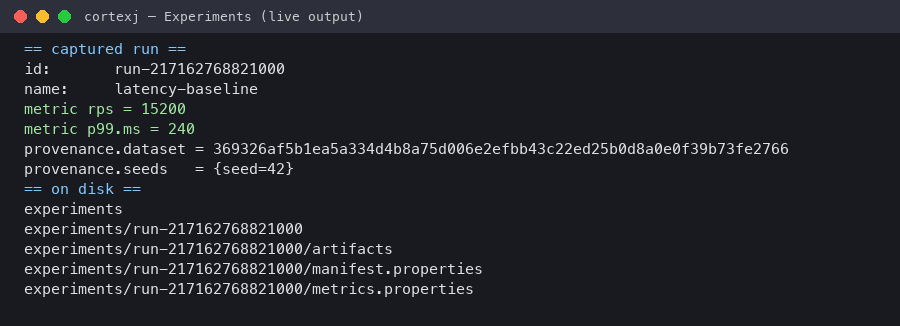

# Experiments

The Experiments track makes every run reproducible by construction:
parameters, metrics, artifacts, model revision, dataset hash, seeds, JDK and
hardware are captured into a local store with embedded provenance. Modules:
`cortexj-experiments-api` (contract) + `cortexj-experiments-local` (filesystem
store).

## Capture a run

```java
ExperimentStore store = new LocalExperimentStore(Path.of("experiments"));
try (Experiment experiment = store.start("my-first-run", 42L, fingerprint,
        ModelIdentity.of("company/model", "rev-1"), "reference/0.1")) {
    experiment.parameter("learningRate", "2e-4");
    experiment.metric("validation.loss", "0.42");
    experiment.artifact(Path.of("adapter.safetensors"));
}
```

`start(name, seed, datasetFingerprint, model, backend)` opens the run; closing
it finalizes. An unclosed experiment is an error state — use
try-with-resources.

## What lands in the record

| Field | Source |
|---|---|
| `id`, `name` | generated + the name you gave |
| parameters | `experiment.parameter(k, v)` — stringly typed, ordered |
| metrics | `experiment.metric(k, v)` |
| artifacts | **copied** into the store (source file untouched) with checksums |
| model identity | `ModelIdentity.of(name, revision)` — the immutable revision |
| dataset fingerprint | the [Data](data.md) fingerprint — content identity |
| seeds | the seed passed to `start()` |
| environment | JDK, JVM vendor, OS/arch, cores, CortexJ version, wall-clock — captured at `start()` |



*Live output: a captured `latency-baseline` run — metrics, dataset fingerprint, seed and the on-disk layout.*

## On disk

```
experiments/
└── runs/<id>/
    ├── manifest.properties     # identity, provenance, parameters
    ├── metrics.properties      # captured metrics
    └── artifacts/              # copied artifacts + checksums
```

Everything is plain properties/files — readable without CortexJ, diffable,
rsync-able. Artifacts are copies; deleting the source after `artifact()` never
corrupts the store.

## Reading runs back

```java
ExperimentRecord record = store.list().get(0);
record.provenance().datasetFingerprint();   // matches the training data
record.provenance().seeds();                // exact seeds used
record.metrics();                           // captured metrics
ExperimentRecord same = store.get(record.id());
```

The double-run reproducibility proof — same seed + same fingerprint ⇒ same
record identity — is asserted in `LocalExperimentStoreTest`.

## Comparing and ranking

`store.list()` returns every record; ranking/comparison utilities are the
0.x boundary — records are plain typed values, so comparison is user code today
(external trackers such as MLflow are a tracked follow-up; `ExperimentStore` is
the seam they plug into).

## Why fingerprints and seeds are first-class

A run is reproducible when three things are pinned: **data** (fingerprint),
**code path** (parameters), **stochasticity** (seeds). The store captures all
three automatically — plus the environment that produced the numbers. A record
without provenance is treated as a defect, not a format.

## Next steps

- [Training & PEFT](training.md) — produce adapter artifacts worth capturing.
- [Data](data.md) — where the fingerprint comes from.
- [Lab & Notebook](lab.md) — interactive runs that become experiments.
